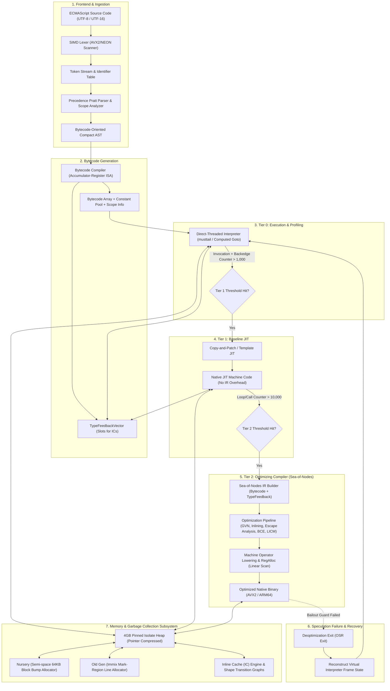
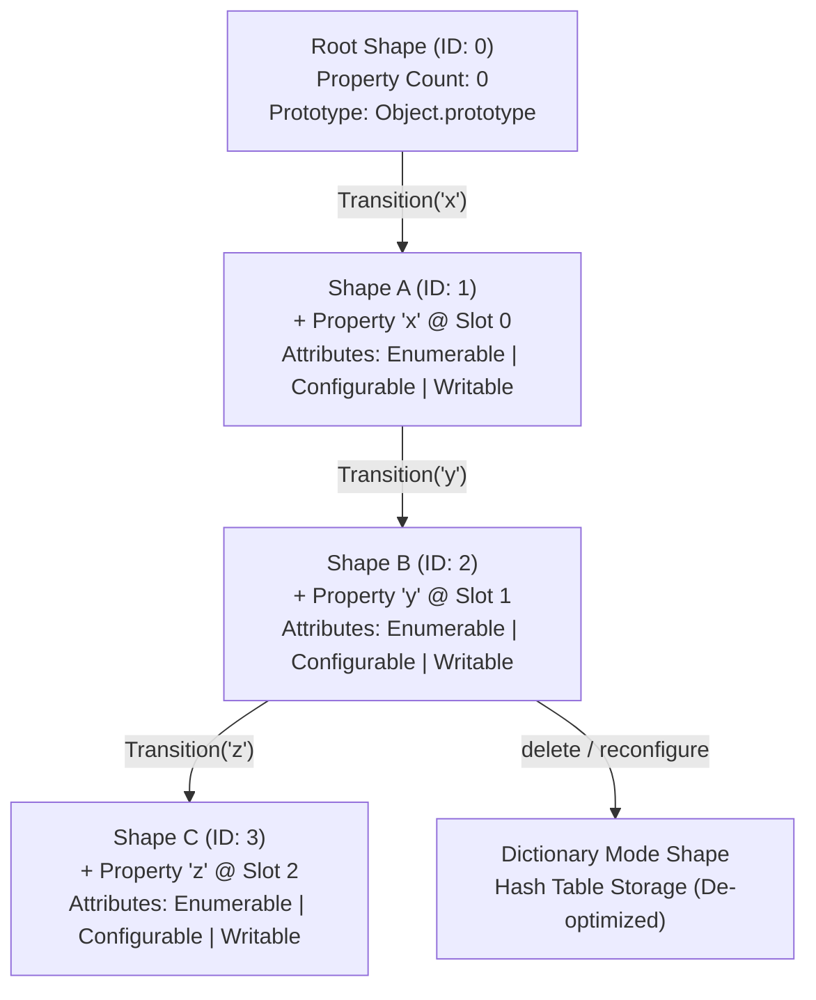
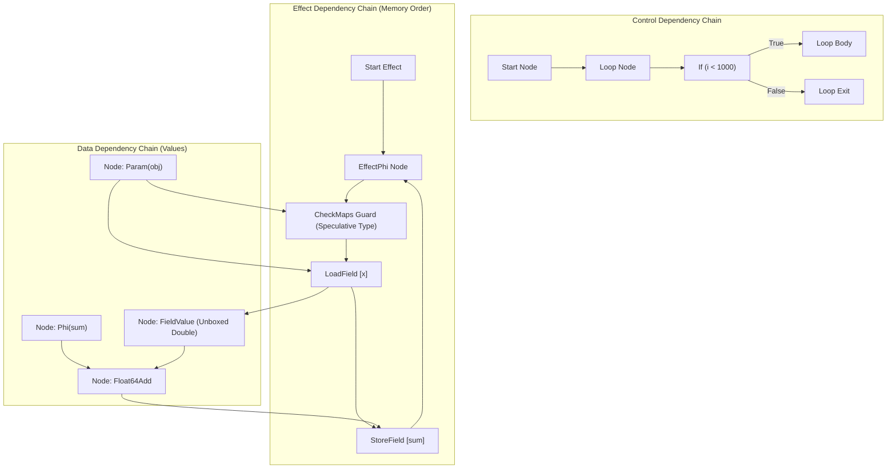
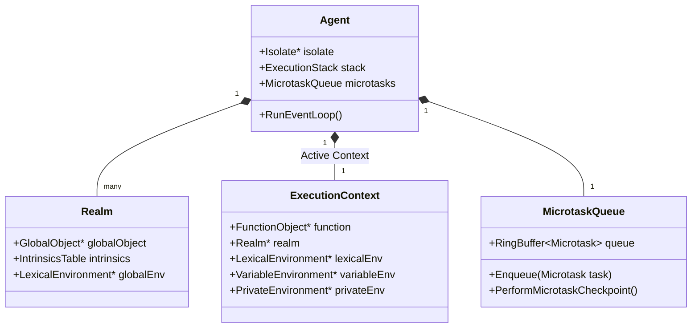

# AetherVM: Next-Generation High-Performance ECMAScript Virtual Machine & JIT Runtime
## Architectural Specification & System Blueprint
**Author**: Principal VM Architect & Lead Systems Compiler Engineer  
**Target Specification**: ECMA-262 14th Edition (ES2023+)  
**Target Architectures**: x86-64-v3 (AVX2/BMI2), ARM64 (ARMv8.2-A+ LSE)  
**Implementation Baseline**: ISO C++23 (`-std=c++23`, `-fno-exceptions`, `-fno-rtti`)

---

## 1. Executive Summary & Systems Engineering Strategy

### 1.1 Architectural Thesis
Modern JavaScript engines (V8, JavaScriptCore, SpiderMonkey) represent peak achievements in runtime engineering, but carry over 15 years of accumulated architectural debt:
- **V8**: Suffers from multi-tier compilation latency during warm-up (Sparkplug -> Maglev -> TurboFan), high memory overhead from extensive metadata structures, and complex pointer compression de-referencing overhead.
- **JavaScriptCore (JSC)**: Uses a 4-tier stack (LLInt -> Baseline -> DFG -> FTL) with B3 as the backend; extremely fast peak performance but complex OSR/deopt protocols between DFG and FTL (LLVM/B3).
- **SpiderMonkey**: Dual-tier WarpMonkey engine relying on CacheIR snapshots, historically constrained by older GC architectures.

**AetherVM** is engineered from first principles around three modern architectural pillars:
1. **Zero-Warmup Tiering**: Fast direct-threaded `musttail` accumulator-register bytecode interpreter (Tier 0) coupled directly with a Copy-and-Patch / Baseline Template JIT (Tier 1) generating native code in sub-millisecond pauses, backed by a unified Sea-of-Nodes speculative optimizing compiler (Tier 2).
2. **Unified 64-bit Pointer-Compressed Memory Subsystem**: Strict 4GB isolate heap window pinned to a dedicated base register (`r14` on x86-64, `x28` on ARM64), enabling 32-bit compressed pointers everywhere with zero offset math, combined with IEEE-754 NaN-boxing for register and inter-tier value passing.
3. **Immix-Style Generational GC with Precise Card-Marking**: 64KB block / 128-byte line Nursery allocation with parallel copying evacuation into an Immix mark-region Old Generation, drastically minimizing fragmentation and stop-the-world (STW) pauses below 1.5ms.

---

### 1.2 Implementation Language Justification: Modern C++23 vs. Systems Rust

| Architectural Requirement | ISO C++23 (`clang++-18` / `g++-14`) | Systems Rust (`1.78+`) | Winner & Justification |
| :--- | :--- | :--- | :--- |
| **Interpreter Dispatch Overhead** | Supported via `[[clang::musttail]]` and direct computed `goto`. Eliminates dispatch table re-fetch and branch mispredictions. | No guaranteed tail-call elimination (`become` is unstable). Forced into `loop { match opcode { ... } }`, causing CPU branch predictor aliasing. | **C++23** |
| **Object Graph & Cyclic GC Pointer Manipulation** | Raw pointer offsets, intrusive list pointers, bit-stealing, and union punning without compiler fights. | Requires ubiquitous `unsafe`, raw pointers (`*mut T`), or complex slot maps, eliminating Rust's safety advantages while adding lifetime noise. | **C++23** |
| **On-Stack Replacement (OSR) & Frame Surgery** | Direct inline assembly manipulation of stack pointers (`rsp`/`rbp`) and dynamic frame reshaping. | Severely restricted by the Rust compiler's ABI assumptions and lack of naked function stabilization. | **C++23** |
| **Pointer Compression & Layout Guarantees** | `[[no_unique_address]]`, standard-layout structs, bitfields, explicit alignment `alignas(T)`. | `#[repr(C)]` is good, but custom DSTs and compressed pointer references require custom wrappers. | **C++23** |
| **Modern Expressiveness & Type Safety** | C++23 Concepts, `std::expected` (error handling without exceptions), coroutines, explicit SIMD. | Pattern matching, traits, and algebraic types are superior, but insufficient to outweigh low-level VM performance penalties. | **C++23** |

**Architectural Decision**: **Modern ISO C++23**.  
Engine code is compiled with `-std=c++23 -fno-exceptions -fno-rtti -fvisibility=hidden -fstrict-aliasing`. Code safety is guaranteed through static analysis, AddressSanitizer (ASan), UndefinedBehaviorSanitizer (UBSan), custom GC handles (`Handle<T>`, `Root<T>`), and strict isolation of unsafe low-level primitives into audited runtime subsystems.

---

## 2. End-to-End System Pipeline



---

## 3. Virtual Machine Bytecode ISA Architecture

### 3.1 Stack vs. Register vs. Accumulator Evaluation
1. **Pure Stack Machine** (e.g., JVM, WebAssembly):
   - *Pros*: Compact bytecode instructions, trivial code generation.
   - *Cons*: Excessive push/pop bytecodes inflate dispatch count by 2.5x–3x; heavy register allocator overhead when compiling to native machine registers.
2. **Pure Register Machine** (e.g., LuaJIT, JSC LLInt):
   - *Pros*: Minimizes total bytecode count; maps smoothly to physical CPU registers.
   - *Cons*: Variable 3-address operand encodings (`Add dst, src1, src2`) cause significant bytecode bloat (16-32 bits per instruction), thrashing L1 instruction caches.
3. **Accumulator-Register Hybrid** (AetherVM & V8 Ignition):
   - *Decision*: **Explicit Accumulator + Virtual Register ISA**.
   - *Architecture*: An implicit accumulator register (`acc`) holds intermediate results. Operations default to `acc = op(acc, reg)`. Most operations require only 1 or 2 operand bytes.
   - *Result*: 40% smaller bytecode than pure register machines, with dispatch frequency 50% lower than stack machines.

### 3.2 Instruction Encoding & Operand Formats
All instructions consist of an **8-bit Opcode** followed by 0, 1, 2, or 3 operands:
- Registers are encoded as signed/unsigned indices relative to the frame pointer:
  - Local variables: `r0`, `r1`, `r2` (negative offsets from frame pointer `fp - index * 8`).
  - Function arguments: `a0`, `a1`, `a2` (positive offsets from frame pointer `fp + (index + 2) * 8`).
  - Accumulator: Implicit architectural register `acc`.
- Operand prefixes support scaling without bloating the common case:
  - Default: 8-bit operands (`uint8_t` / `int8_t`).
  - `Wide` prefix (`0xFE`): Expands following operands to 16-bit (`uint16_t`).
  - `ExtraWide` prefix (`0xFF`): Expands following operands to 32-bit (`uint32_t`).

```
[Opcode: 8-bit] [Operand 0: 8/16/32-bit] [Operand 1: 8/16/32-bit] [FeedbackSlot: 16-bit]
```

### 3.3 Core Bytecode Instruction Set Architecture (Sample Specification)

| Opcode Group | Mnemonic | Operands | Operational Semantics | Feedback Slot |
| :--- | :--- | :--- | :--- | :--- |
| **Loads & Stores** | `LdaConstant` | `idx: ConstIdx` | `acc = ConstantPool[idx]` | - |
| | `LdaNamed` | `obj: Reg, name: ConstIdx` | `acc = GetNamedProperty(obj, name)` | `SlotId` |
| | `StaNamed` | `obj: Reg, name: ConstIdx` | `SetNamedProperty(obj, name, acc)` | `SlotId` |
| | `LdaKeyed` | `obj: Reg, key: Reg` | `acc = GetKeyedProperty(obj, key)` | `SlotId` |
| | `StaKeyed` | `obj: Reg, key: Reg` | `SetKeyedProperty(obj, key, acc)` | `SlotId` |
| | `Ldar` | `src: Reg` | `acc = Reg[src]` | - |
| | `Star` | `dst: Reg` | `Reg[dst] = acc` | - |
| | `LdaZero` / `LdaNull` / `LdaUndefined` | - | `acc = Smi(0) / Null / Undefined` | - |
| **Arithmetic / Logic** | `Add` | `src: Reg` | `acc = ToNumeric(acc) + ToNumeric(Reg[src])` | `SlotId` |
| | `Sub` / `Mul` / `Div` / `Mod` | `src: Reg` | `acc = acc [op] Reg[src]` | `SlotId` |
| | `BitwiseAnd` / `BitwiseOr` / `BitwiseXor` | `src: Reg` | `acc = ToInt32(acc) [op] ToInt32(Reg[src])` | `SlotId` |
| | `Inc` / `Dec` | - | `acc = acc + 1 / acc - 1` | `SlotId` |
| **Comparisons** | `TestEqual` / `TestStrictEqual` | `src: Reg` | `acc = (acc == Reg[src])` | `SlotId` |
| | `TestLessThan` / `TestGreaterThan` | `src: Reg` | `acc = (acc < Reg[src])` | `SlotId` |
| **Control Flow** | `Jump` | `offset: Imm` | `pc += offset` | - |
| | `JumpIfTrue` / `JumpIfFalse` | `offset: Imm` | `if (ToBoolean(acc) == cond) pc += offset` | - |
| | `JumpIfNull` / `JumpIfUndefined` | `offset: Imm` | `if (acc == Null/Undefined) pc += offset` | - |
| **Function Calls** | `CallAny` | `callee: Reg, args: RegSpan, argCount: Imm`| `acc = Call(callee, args, argCount)` | `SlotId` |
| | `Construct` | `ctor: Reg, args: RegSpan, argCount: Imm` | `acc = Construct(ctor, args, argCount)` | `SlotId` |
| | `Return` | - | `PopFrame(); return acc;` | - |
| **Tiering & Profiling**| `ProfileBackedge` | `offset: Imm` | `feedback.TickLoop(); if (Hot) TriggerOSR();` | `SlotId` |

---

## 4. Memory Model, Tagging & Object Topology

### 4.1 Tagged Value Representation: Double NaN-Boxing vs. Compressed Pointers

AetherVM employs a dual-representation strategy tailored to the execution boundary:
1. **In-Register / C++ Value Passing**: **64-bit IEEE-754 NaN-Boxing**
   Standard IEEE-754 double-precision floats have 52 fraction bits. Any value with exponent `0x7FF` and a non-zero fraction is a NaN. By setting the quiet bit (`bit 51`), the hardware never traps. The remaining 51 bits encode types and payloads:

```
Double (Normal): [S][11-bit Exponent != 0x7FF][52-bit Mantissa]
Quiet NaN Base:  [0][11111111111][1][000000000000000000000000000000000000000000000000000] = 0x7FF8_0000_0000_0000

Tagged Values:
+-------------------+-----------------+------------------------------------------------+
|  Tag (Bits 50:48) | Type            | Payload (Bits 47:0)                            |
+-------------------+-----------------+------------------------------------------------+
|  000              | Smi (Int32)     | Sign-extended 32-bit integer in bits 31:0      |
|  001              | Pointer (Heap)  | 48-bit Canonical Virtual Address               |
|  010              | Boolean         | 0 = false, 1 = true                            |
|  011              | Undefined       | 0                                              |
|  100              | Null            | 0                                              |
|  101              | Symbol / String | Compressed Heap String/Symbol Pointer          |
|  110              | Empty / Uninit  | Internal VM sentinel marker                    |
+-------------------+-----------------+------------------------------------------------+
```

2. **In-Heap Object Field Representation**: **Pointer Compression (32-bit Offsets)**
   Heap memory is allocated within a single, contiguous **4GB virtual memory reservation** (`HeapBase`).
   - All heap pointers stored in heap objects are compressed into **32-bit unsigned offsets**:
     $$\text{RawPointer} = \text{HeapBase} + (\text{CompressedPtr} \ll 3)$$
   - The lowest bit of a 32-bit compressed slot is the **Smi Tag**:
     - `Bit 0 == 0`: **Small Integer (Smi)**: Stored shifted right by 1 bit (31-bit signed payload).
     - `Bit 0 == 1`: **Heap Object Pointer**: Stored as an 8-byte aligned offset (bits 31:1 yield 31 bits = 2GB direct object addressability, or 4GB with 8-byte alignment).
   - Dedicated CPU Register Reservation:
     - x86-64: `r14` is permanently reserved for `HeapBase`.
     - ARM64: `x28` is permanently reserved for `HeapBase`.
     - Address calculation: `lea rax, [r14 + rbx * 8]` (single instruction, zero latency overhead).

### 4.2 JSObject Topology & Memory Layout

Every JavaScript object in the heap adheres to a strictly aligned 32-byte minimum header:

```
JSObject Memory Layout (Compressed 32-bit Heap Slots):
+0x00: [ Shape / HiddenClass Pointer (Compressed: 32 bits) ]
+0x04: [ Elements Pointer (Compressed: 32 bits)           ] -> Points to FixedArray (numeric keys)
+0x08: [ Out-Of-Line Properties Pointer (32 bits)         ] -> Points to PropertyArray (overflow)
+0x0C: [ In-Object Slack / Property Count (32 bits)       ]
+0x10: [ In-Object Slot 0 (32 bits: Tagged / Compressed)  ]
+0x14: [ In-Object Slot 1 (32 bits: Tagged / Compressed)  ]
+0x18: [ In-Object Slot 2 (32 bits: Tagged / Compressed)  ]
+0x1C: [ In-Object Slot 3 (32 bits: Tagged / Compressed)  ]
...    [ Up to N pre-allocated In-Object Property Slots   ]
```

### 4.3 Hidden Classes (Shapes) & Transition Trees
To optimize dynamic property lookups, objects share immutable `Shape` descriptors organized as directed acyclic transition trees:



**Shape Internal Representation**:
- `ShapeID` (32-bit unique index for fast IC comparisons).
- `Prototype` (Compressed pointer).
- `TransitionTable` (Hash table / compact array of `[Symbol/String, NextShape]`).
- `PropertyDescriptorTable`: Array mapping property keys to `[SlotIndex, Attributes (Writable/Enumerable/Configurable), Representation (Tagged/Double/Smi)]`.

### 4.4 Inline Caching (IC) Architecture
Every property access site (`LdaNamed`, `StaNamed`) in bytecode references a dedicated entry in the `TypeFeedbackVector`. The site transitions through three distinct phases:

1. **Monomorphic IC**:
   - The feedback slot stores a pair: `(ExpectedShape, CachedSlotOffset)`.
   - Fast path check in native code / interpreter:
     ```asm
     cmp [r_obj + ShapeOffset], r_expected_shape
     jne .L_ic_miss
     mov r_acc, [r_obj + r_cached_offset]
     ```
2. **Polymorphic IC** (Degree 2 to 4):
   - When a second shape is encountered, the IC upgrades to a Polymorphic handler array:
     `[(Shape1, Offset1), (Shape2, Offset2), (Shape3, Offset3), (Shape4, Offset4)]`.
   - Linear unrolled comparison loop in JIT code.
3. **Megamorphic IC** (Degree > 4):
   - When shape variance exceeds 4, the call site transitions to **Megamorphic**.
   - Instead of branching inline, the site invokes a shared, cache-aligned **Global Megamorphic Stub**:
     - Computes hash: `hash = (ShapeID ^ PropertySymbolHash) & GlobalCacheMask`.
     - Probes global secondary hash table for `(Shape, PropertyKey) -> (Offset, Handler)`.
     - If miss: Falls back to full runtime property lookup and populates global cache.

---

## 5. Execution Engine & Multi-Tier JIT Architecture

### 5.1 Tiering Pipeline & Execution Thresholds

```
Execution Flow:
+------------------------------------------------------------------------------------+
| Tier 0: Direct-Threaded Bytecode Interpreter (musttail dispatch)                   |
| - Zero compilation latency. Gathers shape and type feedback into FeedbackVector.  |
+------------------------------------------------------------------------------------+
                                      |
                     [Invocation + Backedges > 1,000]
                                      v
+------------------------------------------------------------------------------------+
| Tier 1: Copy-and-Patch / Baseline Template JIT                                     |
| - Single-pass linear code generator. Directly compiles bytecode into machine code. |
| - Replaces interpreter dispatch overhead with native branch instructions.         |
| - Fast compilation speed (>100,000 lines/sec). Continues feedback profiling.        |
+------------------------------------------------------------------------------------+
                                      |
                     [Invocation + Backedges > 10,000]
                                      v
+------------------------------------------------------------------------------------+
| Tier 2: Advanced Optimizing JIT (Sea-of-Nodes SSA Compiler)                        |
| - Construct unified Graph IR with Value, Effect, and Control edges.                |
| - Speculative type specialization based on Tier 0/1 FeedbackVectors.               |
| - High-throughput native code generation with aggressive global optimizations.      |
+------------------------------------------------------------------------------------+
```

### 5.2 Tier 0: Direct-Threaded Interpreter with `[[clang::musttail]]`
Traditional `while (true) switch (*pc++)` interpreters suffer from **branch predictor aliasing** because the single indirect jump at the end of the switch statement is reused for every bytecode instruction.

AetherVM implements **direct-threaded dispatch using guaranteed tail calls**:
```cpp
// Interpreter Dispatch Signature
using OpcodeHandler = void (*)(const uint8_t* pc, ExecutionFrame* frame, TaggedValue acc);

// Table of handlers indexed directly by opcode uint8_t
alignas(64) static const OpcodeHandler DispatchTable[256] = {
    &HandleLdaConstant,
    &HandleAdd,
    &HandleStar,
    // ...
};

#define DISPATCH() \
    const uint8_t next_op = *pc; \
    [[clang::musttail]] return DispatchTable[next_op](pc, frame, acc)

void HandleAdd(const uint8_t* pc, ExecutionFrame* frame, TaggedValue acc) {
    uint8_t reg_idx = pc[1];
    uint16_t slot_id = *reinterpret_cast<const uint16_t*>(pc + 2);
    
    TaggedValue lhs = acc;
    TaggedValue rhs = frame->GetRegister(reg_idx);
    
    // Fast path: Monomorphic Smi Addition
    if (__builtin_expect(lhs.IsSmi() && rhs.IsSmi(), 1)) {
        int64_t sum = static_cast<int64_t>(lhs.AsSmi()) + rhs.AsSmi();
        if (__builtin_expect(sum <= INT32_MAX && sum >= INT32_MIN, 1)) {
            acc = TaggedValue::FromSmi(static_cast<int32_t>(sum));
            pc += 4;
            DISPATCH();
        }
    }
    
    // Slow path: Speculation miss / Heap Number / String concatenation
    acc = Runtime_Add(frame, lhs, rhs, slot_id);
    pc += 4;
    DISPATCH();
}
```

### 5.3 Tier 2: Sea-of-Nodes SSA Intermediate Representation

The optimizing JIT constructs a **Sea-of-Nodes Graph** (derived from Cliff Click's HotSpot C2 and TurboFan). The Sea-of-Nodes unifies data flow, control flow, and side-effect orderings into a single graph without artificial basic-block constraints:

1. **Value Edges**: Standard data dependencies between nodes (e.g., `Add(x, y)`).
2. **Control Edges**: Direct control dependencies (`Start`, `IfTrue`, `IfFalse`, `Merge`, `Loop`).
3. **Effect Edges**: Chained memory side-effects (`EffectPhi`, `StoreField`, `CallRuntime`) ensuring strict ECMA-262 observable order without locking code into arbitrary basic blocks.



#### Optimization Pipeline Passes:
1. **Inlining Pass**: High-frequency monomorphic function call sites identified by the feedback vector are inlined directly into the caller graph up to a 60-node cost budget.
2. **Type Specialization & Check Insertion**: The compiler queries the `TypeFeedbackVector`. If an addition was 100% `Smi`, it inserts a `CheckSmi` node and lowers `JSAdd` into machine `Int32AddWithOverflow`.
3. **Global Value Numbering (GVN)**: Eliminates redundant computations across the entire program graph using hash-consing.
4. **Escape Analysis & Scalar Replacement of Aggregates (SRA)**: Objects allocated within a function that do not escape into the global heap or call frames are dismantled into primitive stack/register variables, completely bypassing heap allocation.
5. **Loop-Invariant Code Motion (LICM) & Bounds Check Elimination (BCE)**: Moves invariant guards, map checks, and array length lookups out of hot loops. Array indexing inside counted loops has its bounds check hoisted to a single pre-loop guard.
6. **Machine Lowering & SSA Register Allocation**: Lowers machine nodes to x86-64/ARM64 pseudo-instructions; allocates hardware registers using Linear Scan with register splitting.

### 5.4 On-Stack Replacement (OSR) & Deoptimization

Optimized code is inherently speculative. When a speculative invariant is violated (e.g., a function receives a `String` where only `Int32` was previously observed), the engine must immediately bail out via **Deoptimization**.

```
Deoptimization Sequence:
1. Speculative Guard Fails:
   [cmp r_shape, Shape_Expected] -> [jne .L_bailout_slot_42]

2. Bailout Stub Executes:
   - Preserves all physical CPU registers onto the scratch stack frame.
   - Pushes Bailout ID (index into the JIT Code Metadata Table).
   - Calls C++ Runtime: Deoptimizer::Execute(bailout_id, register_dump).

3. Frame State Reconstruction:
   - Look up the Safepoint / FrameState descriptor mapped to bailout_id.
   - Read the exact location (physical register or stack spill slot) of each virtual register.
   - Materialize any scalar-replaced objects onto the Young Generation heap.
   - Construct standard Tier 0 Interpreter Stack Frames on the execution stack.

4. Return to Interpreter:
   - Adjust stack pointer (RSP) to point to the newly synthesized Interpreter Frame.
   - Set instruction pointer (RIP) to the exact Bytecode Offset following the failed instruction.
   - Resume execution in Tier 0 without observable side effects.
```

---

## 6. Garbage Collector Architecture

### 6.1 Memory Partitioning & Generation Layout

```
AetherVM 4GB Pinned Memory Window (HeapBase = r14):
+------------------------------------------------------------------------------------+
| 0x0000_0000                                                            0xFFFF_FFFF |
+------------------+------------------+---------------------------+------------------+
| Nursery (Semi-1) | Nursery (Semi-2) | Old Generation Space      | Large Object     |
| (64MB)           | (64MB)           | (Immix Block/Line Region) | Space (LOS)      |
| Bump Allocation  | Copy-Evacuate    | ~3.5GB                    | (> 32KB objects) |
+------------------+------------------+---------------------------+------------------+
| <--- Ephemeral Generation --------> | <--- Stable Generation -->| <--- Mapped ---> |
```

### 6.2 Nursery Generation: Block-Based Semi-Space Copying Collector
- **Size**: 64MB per space, subdivided into **64KB Local Blocks**.
- **Allocation**: Thread-Local Allocation Buffers (TLABs) use **Bump Pointer Allocation** (`ptr += size; if (ptr > limit) Fallback();`).
- **Collection**:
  - Minor GC (Scavenge) triggers when Nursery space fills.
  - Roots: Active stack frames, global handles, and **Old-to-Young remembered set**.
  - Surviving objects are evacuated to the alternate semi-space.
  - Objects that have survived $\ge 2$ scavenge cycles are **tenured** directly into the Old Generation.

### 6.3 Old Generation: Immix Line-and-Block Region Allocator
Traditional Mark-Sweep suffers from external fragmentation, while compacting collectors require full object moves and pointer fixups, incurring high STW pauses.
AetherVM adopts the **Immix Space Design**:
- The Old Generation is organized into **32KB Blocks**, each containing **256 Lines of 128 Bytes**.
- **Mark Phase**: Marks both the object header and a bitmask corresponding to the lines occupied by the object.
- **Allocation**:
  - Tries to allocate into contiguous free lines within partially occupied blocks (hole filling).
  - If fragmentation exceeds 20%, an **Evacuation Phase** runs during collection, moving surviving objects out of fragmented blocks into empty blocks, completely defragmenting without full-heap compaction.

### 6.4 Precise Generational Write Barrier & Card Marking
To ensure the Nursery can be collected independently without scanning the multi-gigabyte Old Generation, all stores of heap pointers into heap objects execute a **Card Marking Write Barrier**.

```
Card Table Design:
- 1 Byte per 512 Bytes of Heap memory.
- For a 4GB heap, the Card Table is exactly 8MB:
  CardAddress = CardTableBase + (ObjectAddress >> 9)
```

```asm
; Optimized JIT Inline Write Barrier (x86-64):
; Target object compressed pointer in RAX, Stored value compressed pointer in RDX
test edx, 1                     ; Check if stored value is a HeapObject (Bit 0 == 1)
jz .L_skip_barrier              ; Smis do not require write barriers
shr eax, 9                      ; Convert target object offset to Card Table offset
mov byte [r14 + r_card_offset + rax], 1 ; Mark card as dirty (0x01)
.L_skip_barrier:
```

### 6.5 Concurrency & Latency Mitigation
- **Concurrent Marking**: Background GC threads trace the Old Generation concurrently with JS mutator execution.
- **Snapshot-at-the-Beginning (SATB) Write Barrier**: When concurrent marking is active, overwriting an existing pointer logs the old pointer to a thread-local SATB buffer, preventing mutators from hiding live objects from the concurrent collector.
- **STW Pause Bound**: Targeted at $< 1.5\text{ ms}$ for Nursery scavenges and $< 3.0\text{ ms}$ for Old Gen cycle finalization.

---

## 7. ECMAScript Specification Conformance Architecture



1. **Agent & Isolate**: Encapsulates a distinct thread of execution, its own 4GB memory reservation, GC instance, and JIT compilers. Zero shared heap memory between Agents (true Web Worker memory isolation).
2. **Realms & Intrinsics**: Each Realm contains an immutable vector of pre-instantiated Intrinsic Objects (`%Array.prototype%`, `%Object.prototype%`, `%Function.prototype%`), preventing prototype pollution across execution contexts.
3. **Execution Context Stack**: Physical stack frames track execution contexts. Lexical Scopes are allocated in-object on the heap only if variables escape (captured by closures), otherwise allocated on the physical stack.
4. **Microtask Queue**: Lock-free, cache-friendly ring buffer processing Promise reactions and `queueMicrotask` checkpoints before returning to the host event loop.

---

## 8. Phased Implementation Roadmap

```
Milestone Progression:
+------------------------------------------------------------------------------------+
| Milestone 1: Foundational Scaffolding & Memory Primitives                          |
| - Tagged Value representation (NaN-box & compressed 32-bit pointers).              |
| - HeapObject headers, Shape (Hidden Class) initial transition graph.               |
| - 4GB Isolate Heap reservation and Bump-pointer Nursery allocator.                 |
+------------------------------------------------------------------------------------+
                                      |
                                      v
+------------------------------------------------------------------------------------+
| Milestone 2: Lexing, Parsing & AST IR                                              |
| - SIMD-accelerated Tokenizer & Identifier Interning table.                         |
| - Precedence Pratt Parser supporting ES2023 core grammar & AST representation.     |
| - Scope Analysis & Variable Allocation (Stack vs. Context-allocated variables).    |
+------------------------------------------------------------------------------------+
                                      |
                                      v
+------------------------------------------------------------------------------------+
| Milestone 3: Bytecode ISA Compiler & Tier 0 Direct-Threaded Interpreter            |
| - Accumulator-Register Bytecode Emitter & TypeFeedbackVector layout.               |
| - Direct-threaded musttail dispatch interpreter loop.                              |
| - Execution Context, Call Frame, and Stack Walking primitives.                     |
+------------------------------------------------------------------------------------+
                                      |
                                      v
+------------------------------------------------------------------------------------+
| Milestone 4: Runtime Subsystems & Inline Caching (IC) Engine                       |
| - Monomorphic, Polymorphic, and Megamorphic IC stubs for property accesses.        |
| - Builtin Intrinsics (Object, Array, Number, String, Function, Prototype chains).  |
| - Microtask Queue & Promise resolution mechanics.                                  |
+------------------------------------------------------------------------------------+
                                      |
                                      v
+------------------------------------------------------------------------------------+
| Milestone 5: Generational GC with Immix Old Space & Card Table                     |
| - Precise Card-table marking and generational write barriers.                      |
| - Scavenger (Semi-space young generation copying collector).                       |
| - Immix Mark-Region Old Generation collector with Hole-filling and Evacuation.     |
+------------------------------------------------------------------------------------+
                                      |
                                      v
+------------------------------------------------------------------------------------+
| Milestone 6: Tier 1 Baseline Template / Copy-and-Patch JIT                         |
| - Fast native code generator mapping bytecode directly to x86-64 / ARM64.          |
| - IC stub generation and invocation counting triggers.                             |
+------------------------------------------------------------------------------------+
                                      |
                                      v
+------------------------------------------------------------------------------------+
| Milestone 7: Tier 2 Sea-of-Nodes Optimizing JIT & OSR Deoptimizer                  |
| - Graph IR Construction, GVN, Escape Analysis, Type Specialization, and BCE.       |
| - Linear Scan Register Allocation & Machine Code Assembly generation.              |
| - OSR Entry and Deoptimization Bailout Frame State Reconstruction.                 |
+------------------------------------------------------------------------------------+
```
